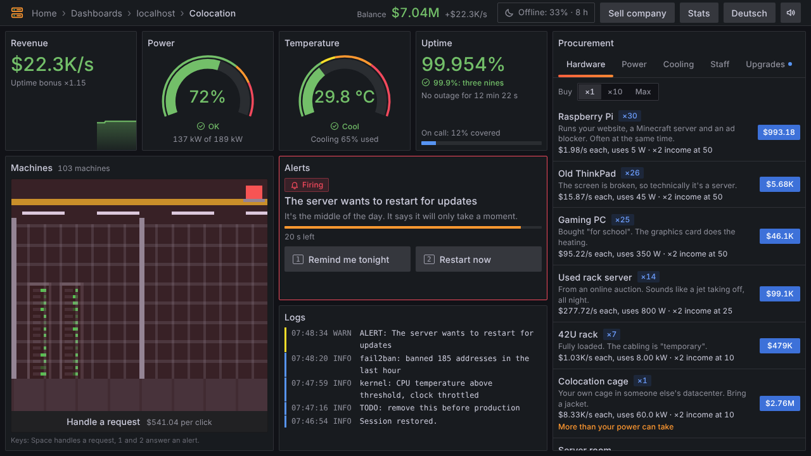
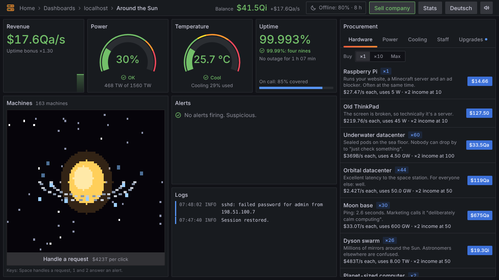

# localhost

An idle game for the browser. You start with a Raspberry Pi in your bedroom and
end with a hyperscale datacenter. Buy machines, keep power and cooling in balance, and watch your
uptime. Now and then an alert fires (a DDoS attack, a full disk, a deploy on Friday afternoon):
click it away in time, or everything goes down.

It looks like a monitoring dashboard (think Grafana), has sound, and is in English and German.





## How it plays

- **Machines** earn money every second, use power, and turn all of it into heat. Sixteen kinds:
  from the Raspberry Pi over the hyperscale region to an underwater datacenter, a moon base and
  a simulated universe. Owning 10, 25, 50… of one kind doubles what each of them earns, and
  every machine has two upgrades of its own.
- **Power**: more machines than your supply can take, and the breaker keeps tripping. Income
  drops fast.
- **Cooling**: above 35 °C the machines slow down; near 50 °C they barely run.
- **Uptime** is what customers pay for. Below 99% they pay less; 99.9%, 99.99% and 99.999% each
  pay a bonus. A new company starts at 99.5% and has to earn its nines.
- **Alerts** come every minute or so (26 of them). Some need one click, some many, some an
  answer (it is always DNS). Solved in time, they pay; missed, they end in an outage. A few are
  good news (the front page of Hacker News, an investor on the phone).
- **Staff** fix the alerts you miss and keep things running while the game is closed.
- **While the game is closed** the machines keep earning: 25% without staff, more with staff
  and with upgrades (on-call phone, self-healing scripts…), for 8 hours, or 24 and 72 with
  upgrades. The toolbar always shows the current numbers.
- **Reincarnation**: sell the company and you are reborn in the bedroom with stock options.
  Each one adds 2% income, forever. Right after the sale, and only then, you spend them on
  twelve upgrades that last through every life: seed money, your old hardware, a macro keyboard that clicks for you, a bot that
  buys power and cooling, cheaper hardware, and more.

The picture of your machines is the big button: click it to handle a request by hand. It shows
where you are (twelve places, from the bedroom to somewhere else entirely) and how things are
going: lights turn amber when the machines are slow and red when everything is down.

Keys: Space handles a request, 1 and 2 answer an alert. The speaker button turns the sound off.

## Run it on your computer

It is plain HTML, CSS and JavaScript: no build step and no packages.

```bash
npm start
```

Then open http://localhost:5173/ (yes). To check the rules of the game:

```bash
npm test
```

## What is where

| Path | What |
| --- | --- |
| `game/` | The game: `index.html`, `style.css`, the scripts and the font. This folder is all a web server needs |
| `game/js/data.js` | Every number: prices, income, power, alerts. Change the balance here |
| `game/js/sim.js` | The rules, without any screen (the tests run these) |
| `game/js/i18n.js` | Every text, English and German |
| `game/js/main.js` | The screen: drawing, clicks and saving |
| `game/js/scene.js` | The pixel picture of your machines, one place per stage |
| `game/js/chart.js` | The graph and the gauges of the dashboard |
| `game/js/audio.js` | The sounds, made in the browser (no sound files) |
| `game/fonts/` | The Inter font (SIL Open Font License, see `LICENSE.txt` there) |
| `tests/` | Tests for the rules and the texts |
| `docs/` | Screenshots for this page |

## Saving

The game keeps its progress in the browser's `localStorage`, under the one key `localhost.save`.
