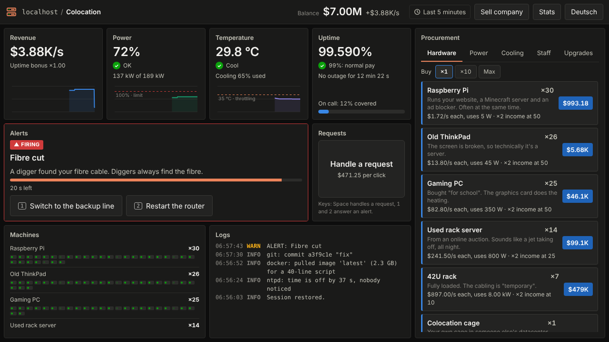

# localhost

An idle game for [Toki](https://playtoki.app). You start with a Raspberry Pi in your bedroom and
grow it into a hyperscale datacenter, then under the sea, into space, through the multiverse to
the end of time, and back home to 127.0.0.1. It has no end. Buy machines, keep power and cooling in balance, and watch your
uptime. Now and then an alert fires (a DDoS attack, a full disk, a deploy on Friday afternoon):
click it away in time, or everything goes down.

It looks like a monitoring dashboard (think Grafana), has sound, and is in English and German.



## How it plays

- **Machines** earn money every second, use power, and turn all of it into heat. Twenty-three
  kinds: from the Raspberry Pi over the hyperscale region to an underwater datacenter, a moon
  base, a simulated universe, a forked universe, a cluster in a time loop, the kernel of reality
  and, last of all, a Raspberry Pi on a desk in a bedroom. Owning 10, 25, 50… of one kind
  doubles what each of them earns (after 400, every 100 more), and every machine has two
  upgrades of its own.
- **Power**: more machines than your supply can take, and the breaker keeps tripping. Income
  drops fast.
- **Cooling**: above 35 °C the machines slow down; near 50 °C they barely run.
- **Uptime** is what customers pay for. Below 99% they pay less; 99.9%, 99.99% and 99.999% each
  pay a bonus. A new company starts at 99.5% and has to earn its nines.
- **Alerts** come every minute or so (35 of them). Some need one click, some many, some an
  answer (it is always DNS). Solved in time, they pay; missed, they end in an outage. A few are
  good news (the front page of Hacker News, an investor on the phone).
- **Staff** fix the alerts you miss and keep things running while the game is closed.
- **While the game is closed** the machines keep earning: 25% without staff, more with staff
  and with upgrades (on-call phone, self-healing scripts…), for 8 hours, or 24, 72 hours and a
  week with upgrades, and longer with the holiday mode. The toolbar always shows the current numbers.
- **Reincarnation**: sell the company and you are reborn in the bedroom with stock options.
  Each one adds 2% income, forever. Right after the sale, and only then, you spend them on
  sixteen upgrades that last through every life: seed money, your old hardware, a macro keyboard
  that clicks for you, a bot that buys power and cooling (it has a switch in the Power and
  Cooling tabs), cheaper hardware and staff, outage
  insurance, and compound interest, which has no last level.
- **No end**: after the last machine there is always something more. New versions of localhost
  (2.0, 3.0, … up to 90.0) each earn half as much again, every 100 more of a machine double its
  income, and compound interest goes on forever. An active player reaches the last machine after
  about two days of play.

The picture of your machines is the big button: click it to handle a request by hand. It shows
where you are (sixteen places, from the bedroom to the end of time and back) and how things are
going: lights turn amber when the machines are slow and red when everything is down.

Keys: Space handles a request, 1 and 2 answer an alert. The speaker button turns the sound off.

## Run it on your computer

It is plain HTML, CSS and JavaScript: no build step and no packages.

```bash
npm start
```

Then open http://localhost:5173/ (yes). To check the rules of the game:

```bash
npm test
```

## What is where

| Path | What |
| --- | --- |
| `game/` | The game as Toki serves it: `index.html`, `style.css`, the cover and screenshots |
| `game/js/data.js` | Every number: prices, income, power, alerts. Change the balance here |
| `game/js/sim.js` | The rules, without any screen (the tests run these) |
| `game/js/i18n.js` | Every text, English and German |
| `game/js/main.js` | The screen, saving, and what the game tells Toki |
| `game/js/scene.js` | The pixel picture of your machines, one place per stage |
| `game/js/chart.js` | The graph and the gauges of the dashboard |
| `game/js/audio.js` | The sounds, made in the browser (no sound files) |
| `game/fonts/` | The Inter font (SIL Open Font License, see `LICENSE.txt` there) |
| `toki.json` | What Toki shows about the game: texts, achievements, high-score lists |
| `tests/` | Tests for the rules, the texts and `toki.json` |

## On Toki

The game follows [Toki's guide for games](https://www.playtoki.app/agents.md):

- **Saves**: the game keeps its progress in `localStorage` under one key (`localhost.save`).
  Toki's save script copies that into the player's account by itself.
- **High scores**: three lists. The main one is the score (1000 points for every ten times more
  money earned in total, so it fits Toki's limit however long someone plays), `streak` is the
  longest time without an outage, and `speedrun` the fastest time to a hyperscale region.
- **Achievements**: 30 (the most Toki allows), listed in `toki.json`. Toki shows "Achievement
  unlocked" itself.

### Putting it on Toki

The easiest way: on Toki, add the game under **My games → Add game** and choose
**From GitHub** with this repository and the `main` branch. `toki.json` tells Toki that the game is in the `game` folder,
and from then on every push to `main` updates the game.

Or with an upload key (from **My games → Upload keys** on Toki):

```bash
curl -fsSL https://www.playtoki.app/toki-upload.mjs -o toki-upload.mjs
```

```bash
TOKI_KEY="toki_…" node toki-upload.mjs
```

For a new version with news for players, raise `version` in `toki.json` and write `notes`.
